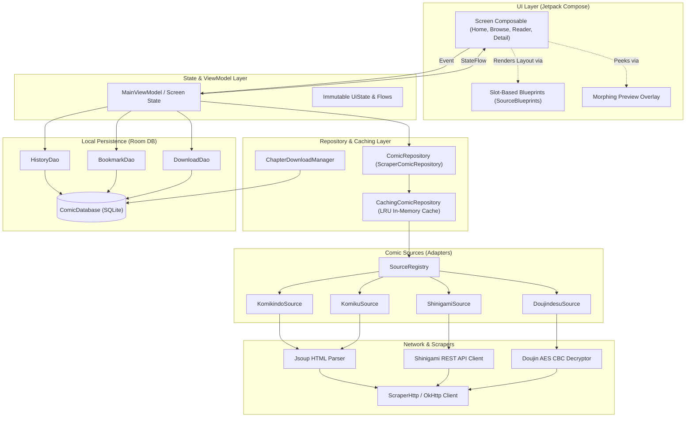

# Arsitektur Sistem — Onlasdan Android

Dokumen ini menjelaskan arsitektur perangkat lunak, pola desain, dan aliran data yang mendasari aplikasi **Onlasdan Android**.

---

## 1. Prinsip Desain Inti

1. **Unidirectional Data Flow (UDF)**:
   - State mengalir satu arah ke bawah (`ViewModel` / `UiState` -> `@Composable`).
   - Event mengalir satu arah ke atas (User Action -> Lambdas -> `ViewModel`).
2. **Pemisahan Sumber (Source Abstraction)**:
   - Komponen UI dilarang keras memanggil scraper atau parser HTTP secara langsung.
   - Semua interaksi sumber wajib melalui interface `ComicSource` dan `ComicRepository`.
3. **Stateless Composable**:
   - Logika bisnis di-hoist ke ViewModel atau State Holder terpisah; composable murni menangani rendering visual dan gestur.

---

## 2. Diagram Aliran Data Sistem

---

## 3. Slot-Based Blueprint Architecture

Onlasdan menggunakan sistem layout modular bernama **Screen Blueprints**:
- Setiap ComicSource mengimplementasikan `SourceBlueprints` (`home`, `browse`, `reader`, `updates`, dll.).
- Layout disusun deklaratif dalam slot (misalnya `ScreenSlot.Body`, `ScreenSlot.Header`, `ScreenSlot.BottomSheet`).
- Tiap slot berisi susunan **Brick** (`HomeBrick.Hero`, `HomeBrick.PopularRow`, `HomeBrick.LatestGrid`, dsb.) yang dievaluasi dengan predikat kondisi (misal `{ it.hasPopular }`).
- **Keuntungan**: Menambah atau mengubah tata letak halaman per-source tidak memerlukan percabangan `if/when(source)` di dalam kode UI Compose.

---

## 4. Lapisan Caching & Kinerja

1. **In-Memory Cache (`CachingComicRepository`)**:
   - Menggunakan `LinkedHashMap` ber-LRU dengan batasan entri (120 item) dan TTL adaptif (5 menit untuk feed, 60 menit untuk detail komik).
   - Menghilangkan jeda putih/loading saat pengguna berpindah-pindah antar tab navigasi.
2. **Coil Image Disk & Memory Cache**:
   - Gambar halaman dan cover disimpan di cache disk dan memory.
   - Menggunakan format gambar WebP/JPEG terkompresi dengan resolusi yang disesuaikan ukuran layar perangkat.
3. **Database Room**:
   - Progres baca, riwayat, dan bookmark dipersistensikan secara lokal dengan indeks unik untuk pencarian instan.

---

## 5. Keamanan & Proteksi

- **Minifikasi R8 Aktif**: Mengaburkan class name dan mengoptimalkan bytecode Android release.
- **V3 Signature Scheme Only**: Memastikan APK tidak dapat dimanipulasi atau di-tamper dengan standar keamanan Android modern.
- **Zero Hardcoded Secrets**: Secret salt atau hashing dilindungi dan dihitung dinamis.
